# SWS405 Digital Forensics – Assignment 2: Memory Forensics Report (Labs 1–5)

---

## 1. Objectives

This report shows how I used memory forensics to recover 10 hidden "flags" (secret text strings) from five Windows memory dumps (MemLabs Labs 1 to 5). Lab 6 is an optional bonus and was not attempted.

A memory dump is a snapshot of a computer's RAM taken while it was running. RAM holds things the user never saved, such as typed commands, open files, passwords and browser history. The goals were to:

- Install and run Volatility 2, a free tool that reads memory dumps.
- Find each lab's flags and prove them with labelled screenshots.
- Keep an honest log of every step, including the dead ends.
- Explain in plain words why each technique worked.


---

## 2. Tools and Setup

I worked on Kali Linux. The official install command did not work on modern Kali, so I used a workaround.

**Steps**

1. Ran Volatility 2.6.1 (Python 2.7) inside a Docker container, with a small wrapper script so I could type `volatility`.
2. Added the community plugin pack (needed for `chromehistory`) with `--plugins=$HOME/volatility-plugins`.
3. Installed helper tools: steghide, unrar, 7-Zip, exiftool, KeePassXC and Mega download tools.
4. Downloaded each lab image from the MemLabs Mega links and extracted it into its own folder.
5. Ran `imageinfo` on each image to find its Windows profile (the "settings" Volatility needs to read it).

**[SCREENSHOT S.1: `volatility --info | head -20` showing Volatility works]**

| Lab | Image | Profile used |
| --- | --- | --- |
| 1 | MemoryDump_Lab1.raw | Win7SP1x64 |
| 2 | MemoryDump_Lab2.raw | Win7SP1x64 |
| 3 | MemoryDump_Lab3.raw | Win7SP1x86_23418 (32-bit) |
| 4 | MemoryDump_Lab4.raw | Win7SP1x64 |
| 5 | MemoryDump_Lab5.raw | Win7SP1x64 |

---

## 3. Lab 1 – Beginner's Luck (3 flags)

**Story:** a computer crashed while its owner was using a terminal, drawing in Paint and opening a locked archive.

### Flag 1: the terminal

1. Ran `imageinfo` to get the profile, then `pslist` to list running programs (cmd.exe, mspaint.exe, WinRAR.exe, DumpIt.exe).
2. Ran `cmdscan`: the user had typed a command, `St4G3$1`.
3. Ran `consoles`: the terminal screen showed a long Base64 string (a way of disguising text).
4. Decoded it with `base64 -d`.

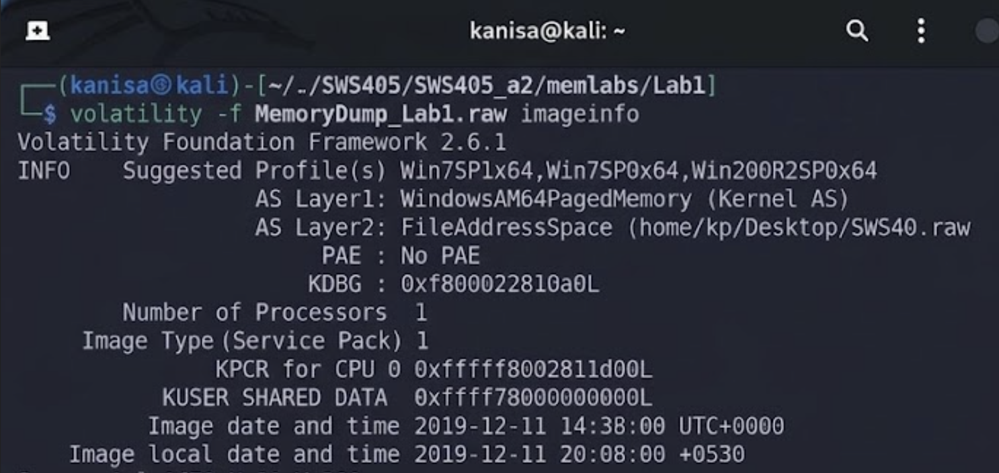

`imageinfo` showing the profile

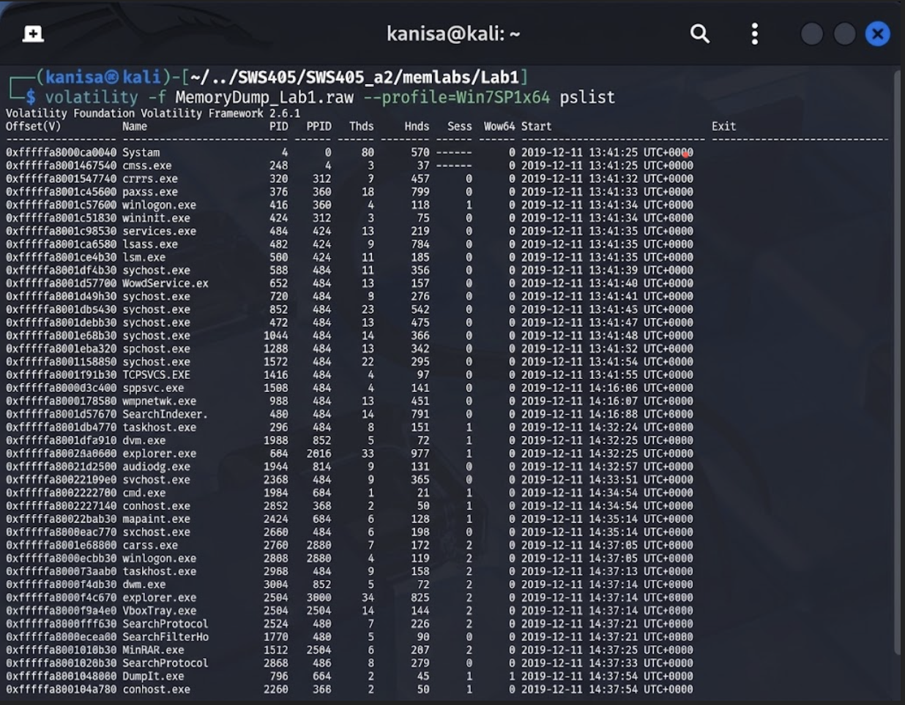

`pslist` showing cmd.exe, mspaint.exe, WinRAR.exe

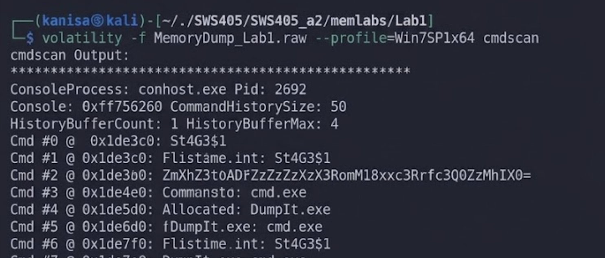

`cmdscan` showing St4G3$1

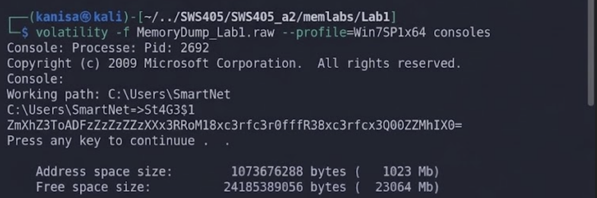

`consoles` showing the Base64 string

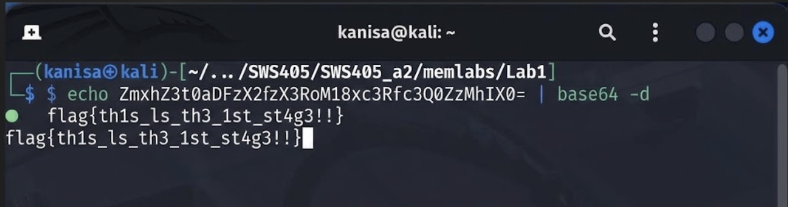

`base64 -d` output with Flag 1

> **Flag 1:** `flag{th1s_1s_th3_1st_st4g3!!}`

### Flag 3: the locked archive

1. Ran `cmdline -p 1512` on WinRAR: it had opened `Important.rar`.
2. Ran `filescan | grep -i important.rar` to find the file, then `dumpfiles` to pull it out of memory.
3. Ran `unrar l`: the archive's note says the password is Alissa's NTLM hash in uppercase.
4. Ran `hashdump` to get the hash `f4ff64c8baac57d22f22edc681055ba6` and typed it in uppercase to unlock the archive.
5. Opened the extracted `flag3.png`.

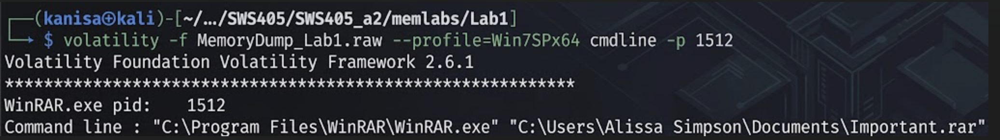

`cmdline` of WinRAR showing Important.rar

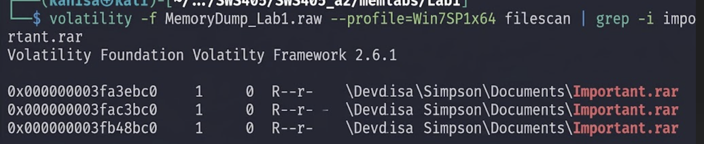

`filescan` output

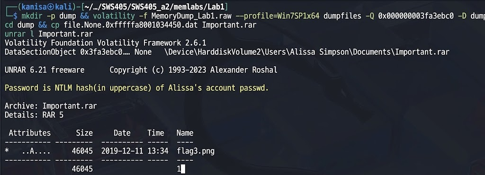

`unrar l` showing the password hint]**

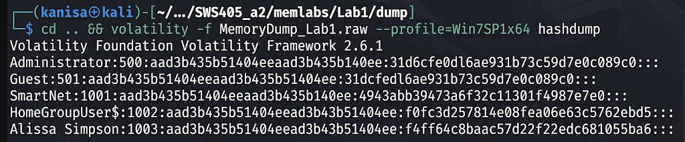

`hashdump` showing Alissa's hash

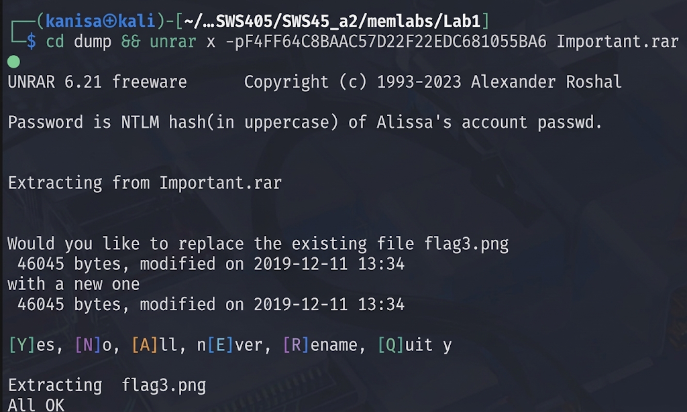

`unrar x` with the uppercase hash succeeding

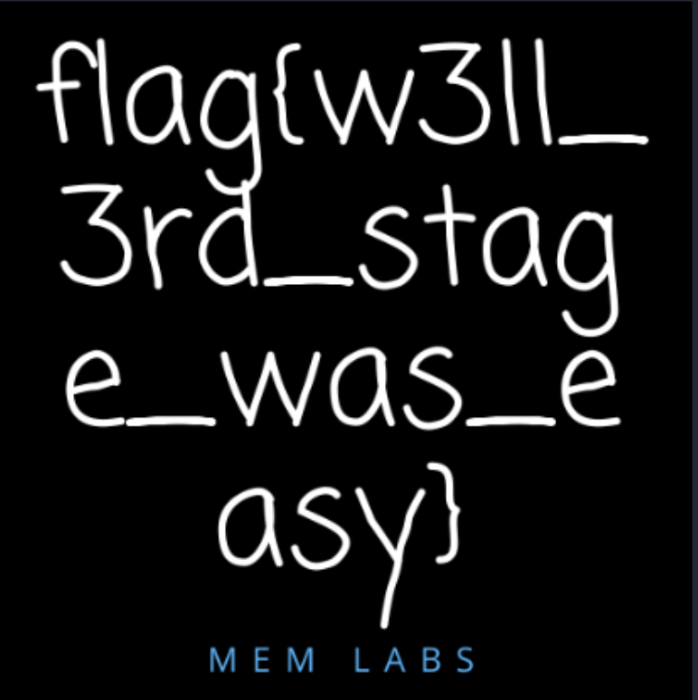

`flag3.png` showing Flag 3

> **Flag 3:** `flag{w3ll_3rd_stage_was_easy}`

### Flag 2: the unsaved drawing

1. Found Paint's process ID (2424) in `pslist`.
2. Ran `memdump -p 2424` to save everything Paint had in memory.
3. Treated the dump as raw pixels and tried several widths. Blank pages and icons were dead ends.
4. Searched for blocks that were mostly white and grey, found one at offset `0xac20000`, and worked out the row width as 819 pixels.
5. Rendered it with my own script: `raw2png.py dump/2424.dmp 0xac20000 819 450 paint.png`.

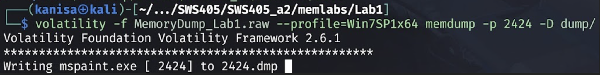

`memdump -p 2424` output

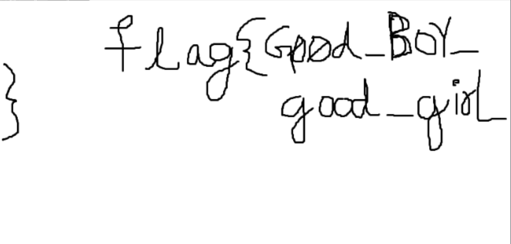

the rendered image showing Flag 2

> **Flag 2:** `flag{Good_BoY_good_girL}`

### Why these tools worked 

- `consoles` reads the terminal's memory, so it shows both what was typed and what the program printed back. `cmdscan` only shows what was typed.
- `hashdump` pulls Windows password hashes straight out of RAM. The archive wanted the hash itself, so no cracking was needed.
- The drawing was never saved, so no file existed. The only copy was inside Paint's memory, so I dumped the process and read the bytes as a picture.

---

## 4. Lab 2 – A New World (3 flags)

**Story:** a user's computer had Chrome and a password manager (KeePass) open. One flag depends on a Lab 1 flag.

### Flag 1: hidden in a setting

1. Ran `pslist`: Chrome and KeePass were running. `cmdscan` only said "Nothing here kids :)" (dead end).
2. Ran `envars` (environment variables, which are settings every program carries) and found an odd one called `NEW_TMP`.
3. Decoded its Base64 value.

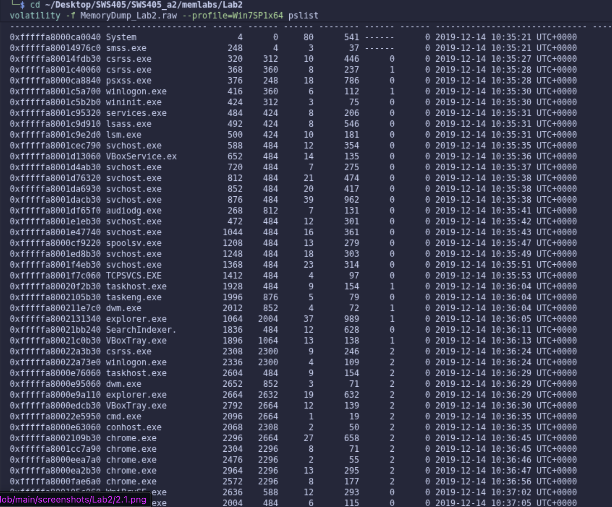

*Figure 2.1 (Lab 2, Flag 1): Listing running processes with `pslist`. Chrome and KeePass were both open when the memory was captured, so they are worth checking.*

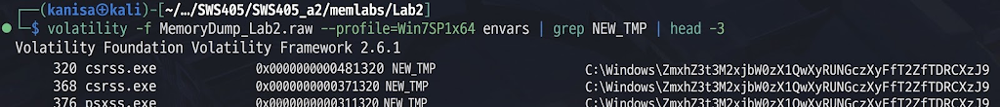

*Figure 2.2 (Lab 2, Flag 1): Listing environment variables with `envars`. One unusual variable, `NEW_TMP`, holds a long Base64 string that looks like hidden data.*

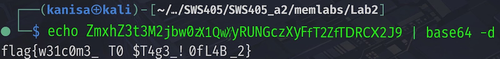

*Figure 2.3 (Lab 2, Flag 1): Decoding the `NEW_TMP` value from Base64. The result is Flag 1.*

> **Flag 1:** `flag{w3lc0m3_T0_$T4g3_!_Of_L4B_2}`

### Flag 2: the password manager

1. Ran `filescan | grep -iE 'kdbx|password'` and found `Hidden.kdbx` (the password database) and `Password.png`.
2. Extracted both with `dumpfiles`.
3. Opened `Password.png`: tiny text in the corner gave the master password, `P4SSw0rd_123`.
4. The database would not open at first because the extracted file had extra padding. Trimming it to its real size (3422 bytes) fixed it.
5. Opened it in KeePassXC and looked in the Recycle Bin. The deleted entry "Sabka Baap" held the flag. (The other entries were decoys.)

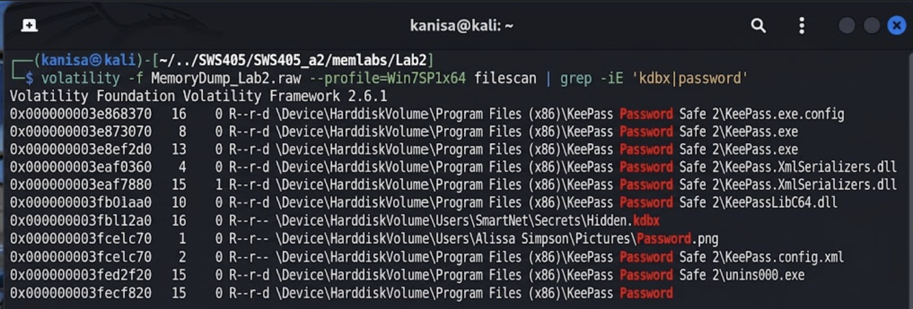

*Figure 2.4 (Lab 2, Flag 2): Searching cached files with `filescan`. It finds `Hidden.kdbx` (the KeePass password database) and `Password.png` (likely the master password).*

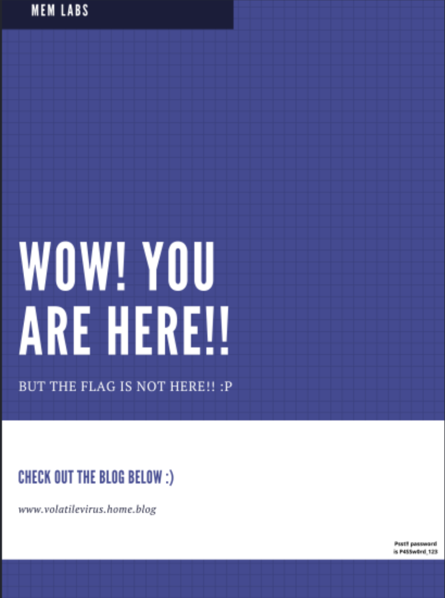

*Figure 2.5 (Lab 2, Flag 2): The extracted `Password.png`. Tiny text in the corner gives the KeePass master password, `P4SSw0rd_123`.*

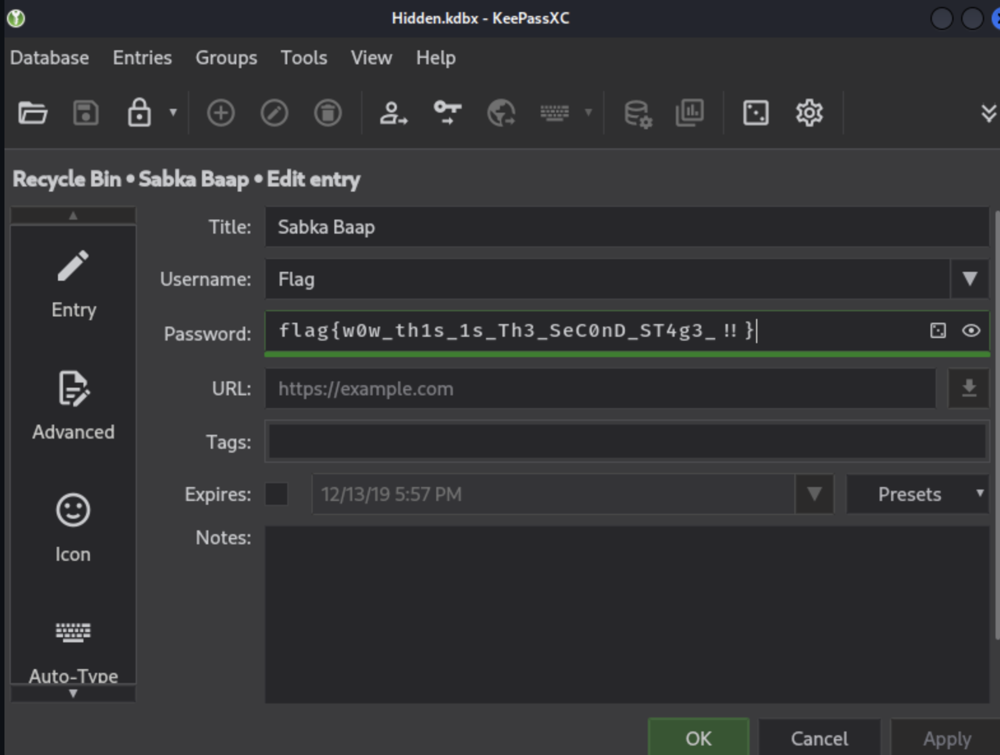

*Figure 2.6 (Lab 2, Flag 2): The database opened in KeePassXC with that password. The deleted entry in the Recycle Bin contains Flag 2.*

> **Flag 2:** `flag{w0w_th1s_1s_Th3_SeC0nD_ST4g3_!!}`

### Flag 3: the browser history

1. Ran `chromehistory` with the plugin pack and found a Mega file-sharing link.
2. Downloaded `Important.zip` from it.
3. The zip's comment said: password is the SHA1 of the Lab 1 stage-3 flag, in lowercase.
4. Hashed the whole flag: `echo -n 'flag{w3ll_3rd_stage_was_easy}' | sha1sum` gave `6045dd90029719a039fd2d2ebcca718439dd100a`.
5. Opened the zip with 7-Zip (plain `unzip` cannot open this kind of zip) and viewed `Important.png`.

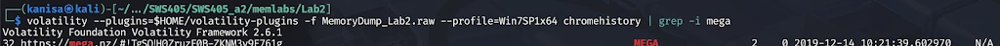

*Figure 2.7 (Lab 2, Flag 3): Reading Chrome's browsing history with `chromehistory`. It shows a Mega file-sharing link, which leads to the next file.*

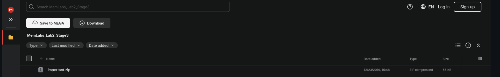

*Figure 2.8 (Lab 2, Flag 3): The Mega folder opened in a browser. It contains `Important.zip`, which I downloaded.*

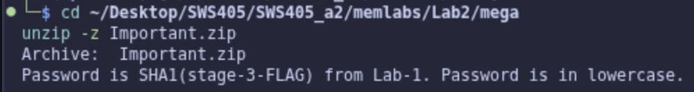

*Figure 2.9 (Lab 2, Flag 3): The comment inside the zip file. It says the password is the lowercase SHA1 hash of the Lab 1 stage-3 flag.*

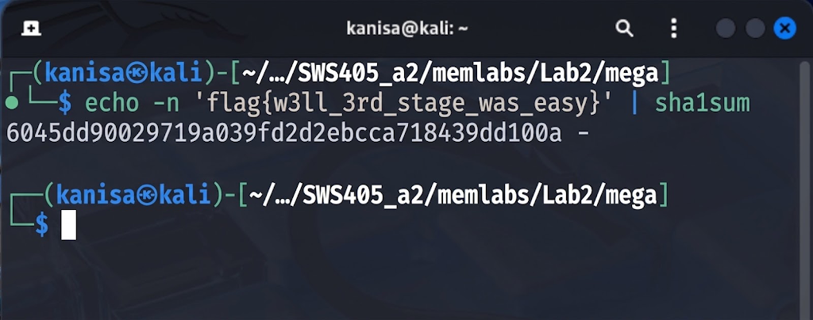

*Figure 2.10 (Lab 2, Flag 3): Building the password with `echo -n '<Lab 1 flag>' | sha1sum`, then extracting the zip with 7-Zip. The successful extraction confirms the password is right.*

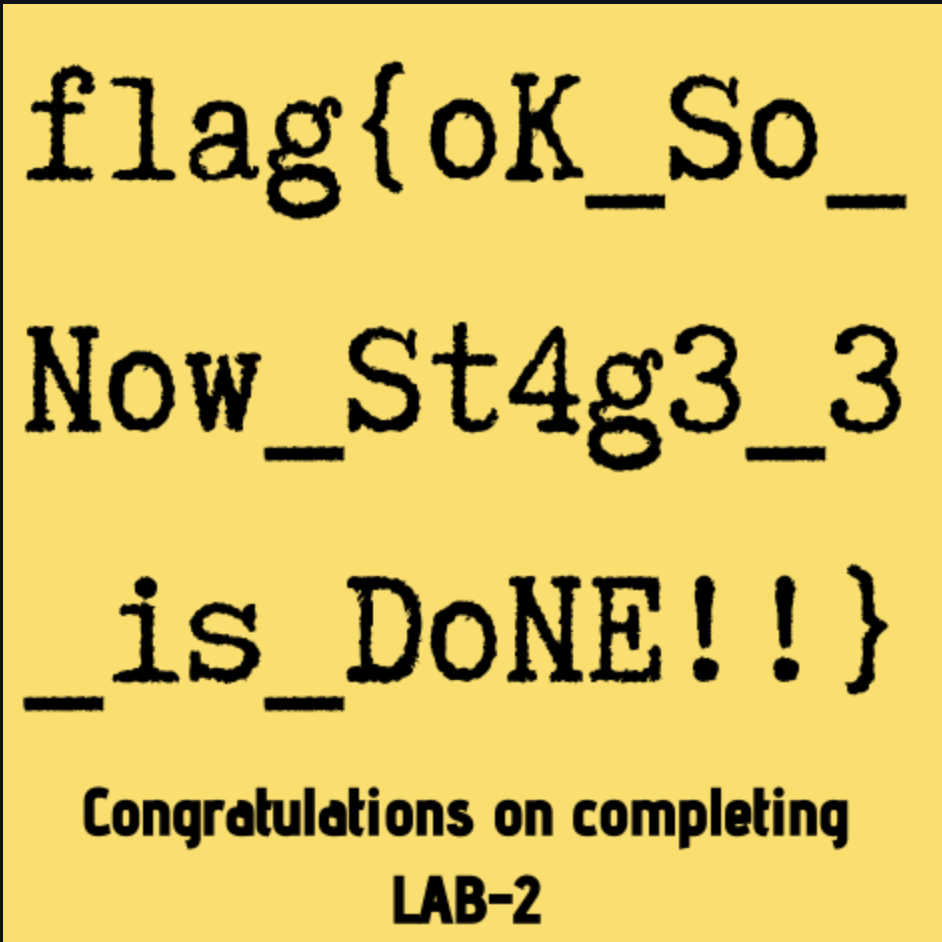

*Figure 2.11 (Lab 2, Flag 3): The extracted `Important.png`. The picture shows Flag 3.*

> **Flag 3:** `flag{oK_So_Now_St4g3_3_is_DoNE!!}`

**How I built the zip password:** I took the full Lab 1 flag (including `flag{` and `}`), ran SHA1 on it with `echo -n` so no hidden new line was added, and used the lowercase hex result.

### Why these tools worked (plain words)

- `envars` works because every program keeps a copy of its settings, so one odd value shows up in every process.
- `filescan` and `dumpfiles` find and rebuild files that Windows keeps cached in RAM.
- Deleting an entry in KeePass only moves it to a Recycle Bin until someone empties it.
- `chromehistory` reads Chrome's saved browsing history straight from memory.

---

## 5. Lab 3 – The Evil's Den (1 flag in 2 halves)

**Story:** a malicious script scrambled a secret. The flag is split in two, and the first half unlocks the second.

**Steps**

1. Ran `imageinfo`: this image is 32-bit (`Win7SP1x86_23418`), unlike the others.
2. Ran `cmdline`: two Notepad windows had `evilscript.py` and `vip.txt` open.
3. Ran `filescan` and `dumpfiles` to extract the script, `vip.txt`, and an odd-named picture, `suspision1.jpeg`.
4. Read the script (without running it) to see what it did.
5. Reversed it with my own short script and got the first half: `inctf{0n3_h4lf`.
6. Used that first half as the passphrase in `steghide extract -sf suspision1.jpeg` and got a hidden file, `secret text`.
7. Joined the two halves.

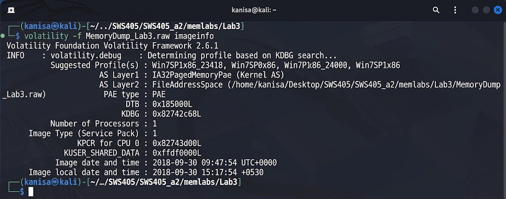

*Figure 3.1 (Lab 3, Flag): Identifying the memory image with `imageinfo`. Unlike the other labs, this one is 32-bit (`Win7SP1x86_23418`), so the profile must match.*

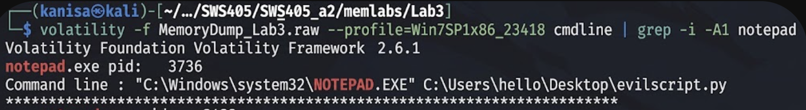

*Figure 3.2 (Lab 3, Flag): Showing program arguments with `cmdline`. Two Notepad windows had `evilscript.py` and `vip.txt` open.*

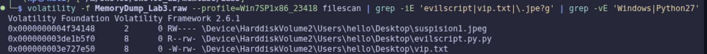

*Figure 3.3 (Lab 3, Flag): Searching cached files with `filescan`. It finds `evilscript.py`, `vip.txt` and the oddly named picture `suspision1.jpeg`, which I then extracted with `dumpfiles`.*

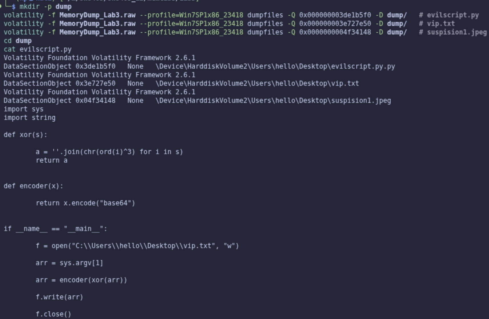

*Figure 3.4 (Lab 3, Flag): The contents of `evilscript.py`. It scrambles the secret with XOR 3 and Base64, and I read it without running it.*

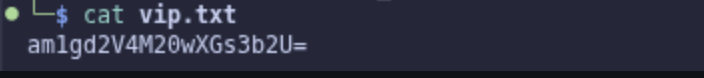

*Figure 3.5 (Lab 3, Flag): The contents of `vip.txt`. This is the scrambled secret that the script produced.*

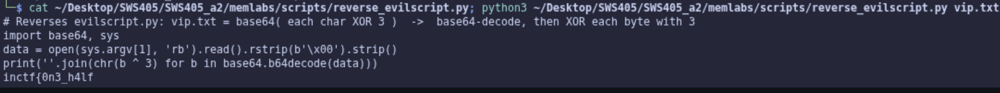

*Figure 3.6 (Lab 3, Flag): My own short script that undoes the scrambling (Base64 decode, then XOR 3). Its output is the first half of the flag, `inctf{0n3_h4lf`.*

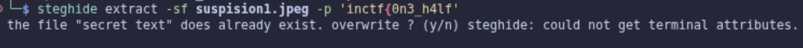

*Figure 3.7 (Lab 3, Flag): Running `steghide extract -sf suspision1.jpeg` with the first half as the passphrase. It succeeds and pulls out a hidden file.*

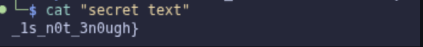

*Figure 3.8 (Lab 3, Flag): The hidden file `secret text`. It holds the second half of the flag, which I joined to the first half.*

> **Flag:** `inctf{0n3_h4lf_1s_n0t_3n0ugh}`

### What the script did (plain words)

The script changed every letter of the secret by a simple XOR with the number 3, then hid the result with Base64 and saved it in `vip.txt`. XOR undoes itself, so I reversed the steps in the opposite order: Base64-decode first, then XOR with 3 again. My script:

```python
import base64, sys
data = open(sys.argv[1], 'rb').read().rstrip(b'\x00').strip()
print(''.join(chr(b ^ 3) for b in base64.b64decode(data)))
```

### Why these tools worked (plain words)

- `cmdline` shows what each program was started with, so it revealed which files Notepad had open even after they were closed.
- `filescan` and `dumpfiles` rebuilt the files from copies Windows keeps in RAM.
- The lab note said the first half is needed for the second, so the first half was the natural steghide passphrase.

---

## 6. Lab 4 – Obsession (1 flag)

**Story:** the user had desktop files, and at least one was deleted before the crash.

**Steps**

1. Ran `imageinfo`, `pslist` and `cmdline`: nothing suspicious.
2. Ran `filescan` on Desktop folders and found `galf.jpeg` ("flag" backwards), `Screenshot1.png` and `Important.txt`.
3. **Dead end:** ran steghide, exiftool and strings on `galf.jpeg`. It only gave a joke note, "Move on bro, there is nothing here :)".
4. Tried `dumpfiles` on `Important.txt`: it wrote nothing.
5. Ran `mftparser` (reads the file index of the disk, still in memory) and searched for `Important.txt`.
6. Found the file's text stored inside its record, removed the line-break bytes, and read the flag.

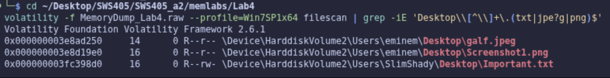

*Figure 4.1 (Lab 4, Flag): Searching the Desktop with `filescan`. It lists `galf.jpeg` ("flag" backwards), `Screenshot1.png` and `Important.txt`.*

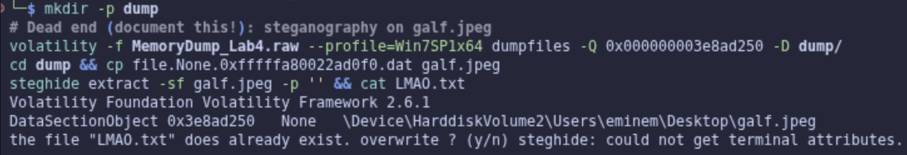

*Figure 4.2 (Lab 4, Flag): Dead end: checking `galf.jpeg` with steghide. It only returns the joke note "Move on bro, there is nothing here :)", so this image is a decoy.*

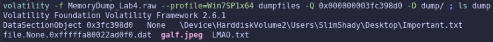

*Figure 4.3 (Lab 4, Flag): Dead end: running `dumpfiles` on `Important.txt`. It writes nothing, because the file's contents are no longer cached in RAM.*

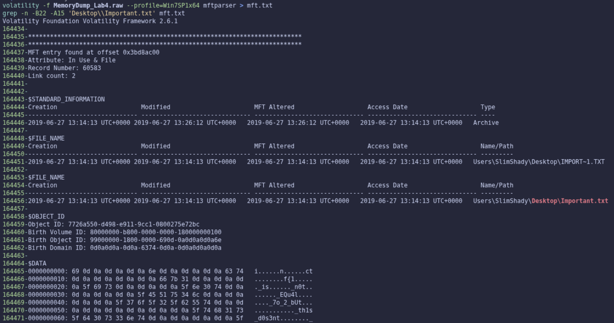

*Figure 4.4 (Lab 4, Flag): Parsing the disk's file index with `mftparser`. The record for `Important.txt` still holds the file's text inside it.*

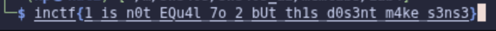

*Figure 4.5 (Lab 4, Flag): Removing the line-break bytes from the text found in the MFT record. The cleaned text is the flag.*

> **Flag:** `inctf{1_is_n0t_EQu4l_7o_2_bUt_th1s_d0s3nt_m4ke_s3ns3}`

### Why `dumpfiles` failed but `mftparser` worked (plain words)

- `filescan` can list a file even when only its "name tag" is left in memory. `dumpfiles` needs the file's actual contents to be cached in RAM, and for `Important.txt` they were gone.
- Windows keeps a small index record for every file (the MFT). A very small file, like this one, has its text stored inside that record. The record was still in memory, so `mftparser` could read the text.
- Lesson: seeing a file in a listing does not mean it can be recovered, and for tiny files the MFT may be the only copy.

**Why I kept the dead end:** it shows I checked the obvious hiding place and ruled it out, and it explains why I moved on to the MFT.

---

## 7. Lab 5 – Black Tuesday (2 flags)

**Story:** a user was working with an archive manager when the system crashed. The first flag is the password for the second.

**Steps**

1. Ran `pslist`: WinRAR.exe (PID 2924) plus several crashed Notepad windows.
2. Ran `cmdline -p 2924`: WinRAR had opened `SW1wb3J0YW50.rar` (Base64 for "Important").
3. Ran `filescan | grep -i '\.rar'` and `dumpfiles` to extract it.
4. Ran `unrar l`: it holds an encrypted `Stage2.png` and needs a password.
5. **Dead end:** `chromehistory` returned an empty table, because this PC did not use Chrome.
6. Ran `iehistory` (Internet Explorer history) and found a very long, Base64-looking filename starting with `ZmxhZ3`.
7. Decoded it to get Flag 1. Following the lab README note, I changed `L4B_3` to `L4B_5`.
8. Used Flag 1 as the archive password with `unrar x` and opened `Stage2.png`.

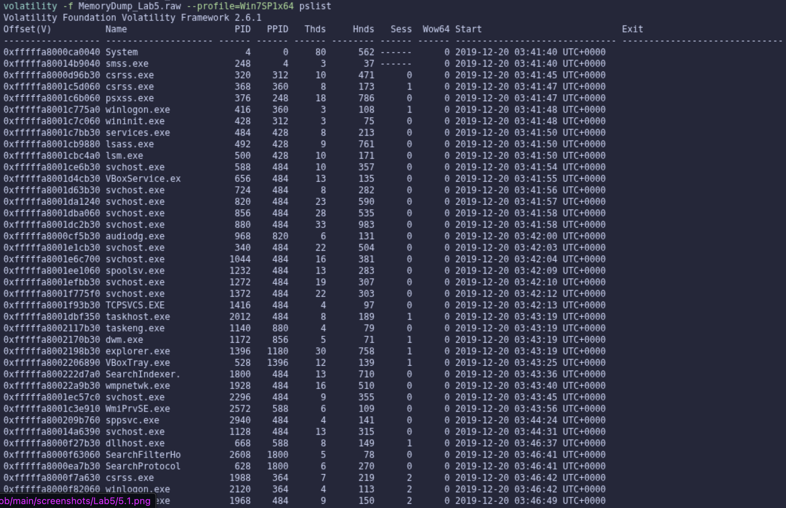

*Figure 5.1 (Lab 5, Flag 1): Listing running processes with `pslist`. WinRAR.exe (PID 2924) is running, along with several crashed Notepad windows.*

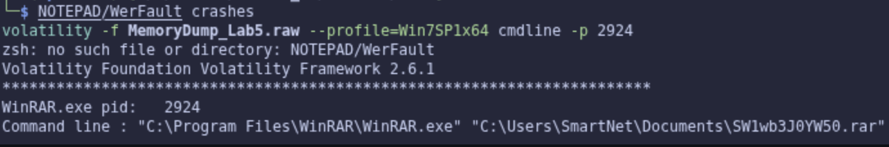

*Figure 5.2 (Lab 5, Flag 1): Checking WinRAR's arguments with `cmdline -p 2924`. It had opened `SW1wb3J0YW50.rar`, which is Base64 for "Important".*

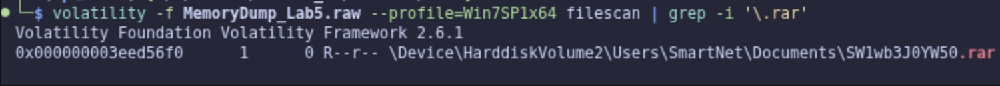

*Figure 5.3 (Lab 5, Flag 1): Locating the archive with `filescan`. It shows the `.rar` file and its memory offset, which I used with `dumpfiles` to extract it.*

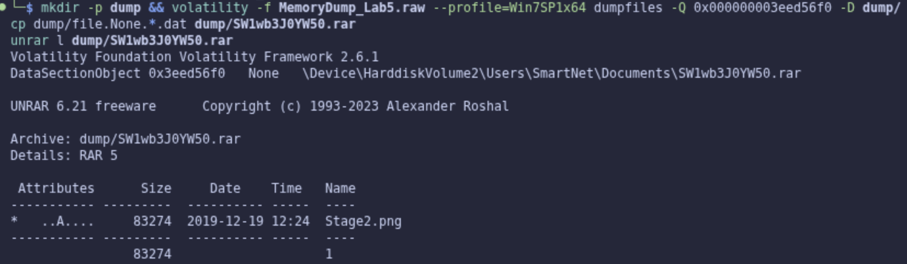

*Figure 5.4 (Lab 5, Flag 1): Listing the archive with `unrar l`. It holds an encrypted `Stage2.png` and needs a password.*

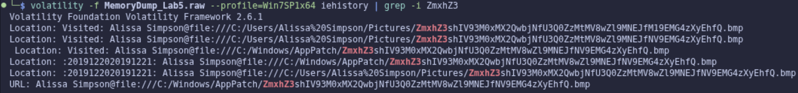

*Figure 5.5 (Lab 5, Flag 1): Reading Internet Explorer history with `iehistory`. One entry has a very long Base64 filename starting with `ZmxhZ3` ("flag").*

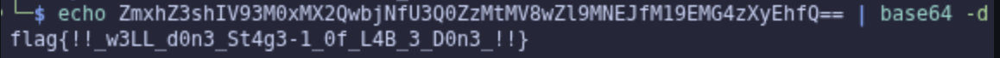

*Figure 5.6 (Lab 5, Flag 1): Decoding that filename from Base64 gives Flag 1 (after changing `L4B_3` to `L4B_5` as the lab README says). This is also the archive password.*

> **Flag 1:** `flag{!!_w3LL_d0n3_St4g3-1_0f_L4B_5_D0n3_!!}`

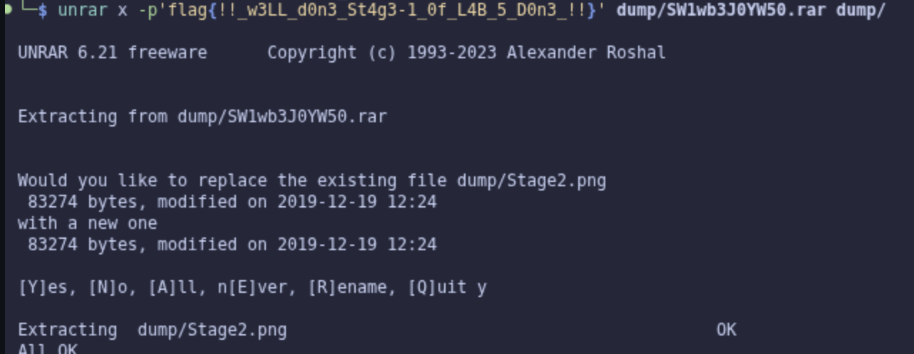

*Figure 5.7 (Lab 5, Flag 2): Extracting the archive with `unrar x` using Flag 1 as the password. The "All OK" message shows the password worked.*

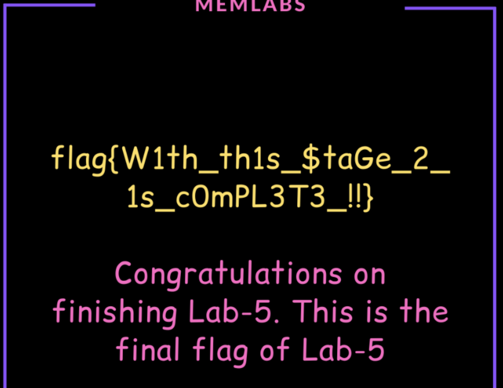

*Figure 5.8 (Lab 5, Flag 2): The extracted `Stage2.png`. The picture shows Flag 2.*

> **Flag 2:** `flag{W1th_th1s_$taGe_2_1s_c0mPL3T3_!!}`

### Which history plugin and why (plain words)

I used `iehistory` because this PC's browsing history is stored in Internet Explorer's own index files. `chromehistory` (used in Lab 2) only reads Chrome's database, which does not exist on this machine, so it returned nothing.

---

## 8. Summary of All Flags

All 10 flags from Labs 1 to 5 were recovered.

| Lab | Flag | Main technique |
| --- | --- | --- |
| 1, Flag 1 | `flag{th1s_1s_th3_1st_st4g3!!}` | `consoles`, then Base64 decode |
| 1, Flag 2 | `flag{Good_BoY_good_girL}` | `memdump` of Paint, read as pixels |
| 1, Flag 3 | `flag{w3ll_3rd_stage_was_easy}` | `filescan`, `dumpfiles`, `hashdump` |
| 2, Flag 1 | `flag{w3lc0m3_T0_$T4g3_!_Of_L4B_2}` | `envars`, then Base64 decode |
| 2, Flag 2 | `flag{w0w_th1s_1s_Th3_SeC0nD_ST4g3_!!}` | `dumpfiles` of .kdbx and Password.png |
| 2, Flag 3 | `flag{oK_So_Now_St4g3_3_is_DoNE!!}` | `chromehistory`, Mega, SHA1 of Lab 1 flag |
| 3 | `inctf{0n3_h4lf_1s_n0t_3n0ugh}` | `cmdline`, XOR reversal, steghide |
| 4 | `inctf{1_is_n0t_EQu4l_7o_2_bUt_th1s_d0s3nt_m4ke_s3ns3}` | `mftparser` |
| 5, Flag 1 | `flag{!!_w3LL_d0n3_St4g3-1_0f_L4B_5_D0n3_!!}` | `iehistory`, then Base64 decode |
| 5, Flag 2 | `flag{W1th_th1s_$taGe_2_1s_c0mPL3T3_!!}` | `dumpfiles` of .rar, Flag 1 as password |


---

## 10. Conclusion

I recovered all 10 flags from Labs 1 to 5 using only the memory images. RAM holds far more than a list of running programs: typed commands, settings, cached copies of files, password hashes, browser history, and records of files that can no longer be extracted.

I followed the checklist from the assignment (scope, commands, settings, files, passwords, deleted data, browser history) instead of hunting for flags directly. That helped me spot dead ends, like the Lab 4 decoy image, sooner. Each flag can be traced to one plugin and one screenshot in this report.